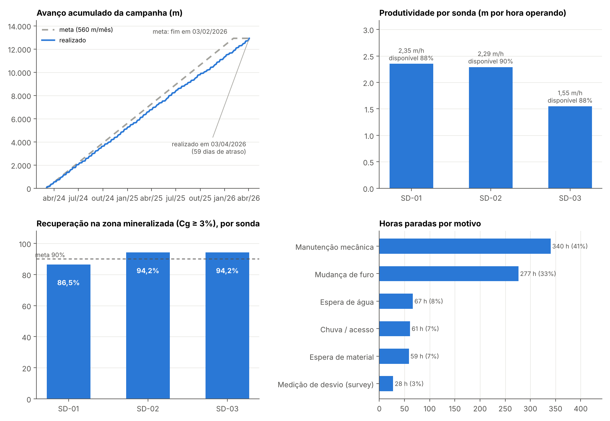

# QA/QC e validação de banco de dados de sondagem (grafita)

**Pergunta:** os teores de grafita deste banco de sondagem são confiáveis para entrar numa estimativa de recurso? Se não forem, quais lotes precisam voltar ao laboratório e quais resultados ficam em espera?

Este projeto reproduz a rotina de um analista de dados geológicos numa campanha de exploração de grafita: acompanhar o avanço das sondas, receber as planilhas de campo e os laudos do laboratório, **validar o banco** (furos, intervalos, códigos, unidades), rodar o **QA/QC** das análises de carbono grafítico (padrões certificados, brancos e duplicatas de campo) e entregar uma **lista de ação**: o que foi corrigido, o que precisa de revisão e quais lotes devem ser reanalisados.

> Os dados são **simulados** (projeto de grafita fictício, campanha de março de 2024 a abril de 2026 com 64 furos e 12.920 m de sondagem diamantada), porque bancos reais de empresas são confidenciais. A simulação segue o formato usual de exportação (collar, survey, litologia, amostragem, laudo com carbono grafítico **Cg** e carbono total **CT**) e inclui de propósito os problemas que aparecem na prática.

Portfólio: https://leticiacerqueira.github.io

## Ferramentas
Python (pandas, NumPy, Matplotlib) · SQL (SQLite: CTEs, window functions, gaps and islands) · Power BI (DAX, modelo estrela)

## Etapas
| Script | O que faz |
|---|---|
| `src/01_gerar_dados.py` | Gera o banco simulado: 64 furos com solo residual, saprolito, gnaisse kinzigítico grafitoso (com a zona mineralizada) e veios pegmatóides; 12.920 amostras de rotina e 1.740 amostras de controle (12% do fluxo) em 72 lotes de laboratório. |
| `src/02_validar_banco.py` | Valida e trata o banco. Cada problema vira uma linha em `saida/log_validacao.csv` com a regra que falhou e a ação: **CORRIGIDO** (correção objetiva e rastreável) ou **REVISAR** (depende de quem conhece o furo ou de confirmação do laboratório). |
| `src/03_qaqc.py` | Cartas de controle dos padrões, gráfico de brancos, precisão das duplicatas de campo (HARD) e decisão por lote: **APROVADO** ou **REANALISAR**. |
| `src/04_consultas_sql.py` + `sql/consultas.sql` | Carrega tudo num SQLite e calcula interceptos significativos, ranking de furos, teor por litologia, impacto do QA/QC e pendências por furo. |
| `src/06_painel_html.py` | Gera o **painel interativo** da campanha (`painel/index.html`, HTML único sem dependências), com filtro por sonda e período, indicadores, gráficos com detalhes ao passar o mouse e a caixa de testemunho de cada furo. |
| `src/07_exportar_powerbi.py` + `powerbi/` | Exporta o modelo estrela (fatos de turnos e manobras, dimensões de furo, sonda, meta e lotes) e gera o **projeto do Power BI** com medidas DAX e 3 páginas ([passo a passo](powerbi/README.md)). |
| `src/05_kpis_sondagem.py` + `sql/kpis_sondagem.sql` | Valida os boletins diários das sondas (4.327 manobras e 612 turnos) e calcula os KPIs da campanha: avanço x meta, produtividade e disponibilidade por sonda, recuperação de testemunho e horas paradas. Exporta tabelas prontas para Power BI em `saida/kpis/`. |

## 1. Validação do banco
**26 ocorrências: 13 corrigidas e 13 para revisar** ([log completo](saida/log_validacao.csv)).

| Tabela | Exemplo encontrado | Ação |
|---|---|---|
| Collar | FD-017 com este e norte trocados (detectado pela faixa de coordenadas UTM) | Corrigido |
| Collar | FD-033 com mergulho +60 no collar e −60 no survey | Corrigido |
| Collar | FD-029 sem cota | Revisar |
| Survey | FD-008: azimute muda 40° entre 60 m e 90 m e volta depois (leitura ruim) | Revisar |
| Litologia | `Gnaisse kinzigítico grafitoso`, `gnaisse kinzigitico grafitoso ` (sem acento e com espaço), `GN. KINZ. GRAF.`, `Saprolito`, `PEGMATITO` (em vez de VEIO PEGMATÓIDE): códigos fora do padrão | Corrigido |
| Litologia | sobreposição em FD-014, lacuna de 1,5 m em FD-025, intervalo além do fundo do furo em FD-038 | Revisar / corrigido |
| Amostragem | amostras lançadas no furo `FD-40`, que não existe (era FD-040) | Corrigido |
| Laudo | teor impossível de 30.171 (veio em ppm: 3,02% Cg), valor −0,02, códigos `-`, `IS`, `NR`, amostra repetida, amostra que não voltou | Corrigido / revisar |
| Laudo | **3 amostras com Cg maior que o carbono total**, o que é impossível (o grafítico é parte do total): provável troca de colunas no laboratório | Revisar |

A lacuna de FD-025 não é detalhe: ela cai **dentro de um intercepto de 11 m a 11,1% Cg**, e a amostra fica sem litologia nas estatísticas até o geólogo descrever o trecho.

## 2. QA/QC das análises
Critérios usados (referências comuns na indústria, ajustáveis no início de `03_qaqc.py`):
- **Padrão certificado:** falha fora de ±3 DP, ou 2 seguidos fora de ±2 DP do mesmo lado, ou média do lote além de ±1,5 DP (viés).
- **Branco:** falha acima de 10 × o limite de detecção (0,20% Cg).
- **Duplicata de campo** (a outra metade do testemunho): 90% dos pares com HARD ≤ 20%. HARD = |A − B| / (A + B).


- **Deriva do laboratório nos lotes L021 a L024:** os três padrões sobem juntos (média do lote de +2,1 a +2,2 DP). O desvio aparece nos três teores ao mesmo tempo, o que mostra que o laboratório passou a ler alto, e não um problema de um padrão só. Os 4 lotes vão para reanálise.
- **L031:** falha pontual (PAD-BAIXO a +3,8 DP). **L029:** dois PAD-BAIXO seguidos acima de 2 DP. Os dois lotes são reprovados.
- **L010:** amostra etiquetada como PAD-MEDIO com o valor do PAD-ALTO. É **troca de padrão no envio**, não erro do laboratório: corrige-se o cadastro, e esse padrão sozinho não reprova o lote. Sem essa checagem, um lote bom seria reanalisado à toa.


- 2 brancos contaminados (0,31% e 0,27% Cg), **sempre logo depois de amostras de grafita maciça** (27,2% e 26,1% Cg). A grafita é macia e gruda no pulverizador, então o material arrasta para a amostra seguinte. L010 e L032 voltam ao laboratório, e a recomendação é limpar o pulverizador com quartzo depois de amostras de alto teor.


**Duplicatas de campo aprovadas:** 546 pares válidos, 99,1% dentro do limite (90% dos pares com até 14% de diferença). A metade do testemunho representa bem o intervalo amostrado. Os pares mais distantes estão nos teores baixos, onde a diferença relativa naturalmente cresce.

## 3. Resultado para o projeto (SQL)
**8 de 72 lotes precisam de reanálise** (L010, L021 a L024, L029, L031 e L032). Eles contêm 11,1% das amostras e **9,6% das amostras mineralizadas** (≥ 3% Cg).

Dos **68 interceptos significativos** (≥ 3% Cg e ≥ 2 m, calculados em SQL com a técnica *gaps and islands*), **9 ficam provisórios** até a reanálise ou a confirmação do Cg > CT, entre eles o **2º e o 5º melhores furos do projeto**.


| Posição | Furo | Intercepto | Status |
|---:|---|---|---|
| 1 | FD-030 | 15 m @ 14,8% Cg | Validado |
| 2 | FD-024 | 17 m @ 10,4% Cg | Provisório |
| 3 | FD-034 | 15 m @ 11,8% Cg | Validado |
| 4 | FD-033 | 10 m @ 15,0% Cg | Validado |
| 5 | FD-028 | 11 m @ 13,1% Cg | Provisório |

Por litologia, o gnaisse kinzigítico grafitoso concentra a mineralização (média de 1,18% Cg, com 5,5% das amostras acima de 3%). O saprolito tem 0,63% Cg, e os veios pegmatóides são estéreis (0,04% Cg): quando cortam a zona mineralizada, diluem o intercepto.

Consultas em [`sql/consultas.sql`](sql/consultas.sql) e resultados em [`saida/sql/`](saida/sql/). A lista de pendências por furo ([`05_pendencias_por_furo.csv`](saida/sql/05_pendencias_por_furo.csv)) é o que vai para a equipe de geologia.

## 4. KPIs da campanha de sondagem
**Painel interativo:** https://leticiacerqueira.github.io/painel-sondagem/

Os boletins diários das sondas (cada manobra do barrilete e as horas de cada turno) passam pela mesma lógica de validação: 2 manobras com **recuperação acima de 100%** e 1 turno com **16 h somadas** num turno de 12 h foram para revisão e ficaram fora dos indicadores ([log](saida/kpis/log_boletins.csv)).



- **Avanço:** a campanha de 12.920 m começou em março de 2024 e terminou em 03/04/2026, **59 dias depois da meta** de 560 m/mês (prevista para 03/02/2026). Só 8 dos 23 meses completos bateram a meta.
- **Produtividade:** a SD-03 perfura 1,55 m por hora operando, contra 2,3 m/h das outras, e **caiu de 1,81 para 1,33 m/h a partir de abril de 2025**. Ela também soma 200 h de manutenção mecânica, quase o triplo das outras. É a sonda que explica o atraso.
- **Recuperação:** na zona mineralizada (trechos do gnaisse kinzigítico grafitoso com ≥ 3% Cg), a SD-01 recuperou só **86,5%** do testemunho, abaixo da meta de 90%, enquanto as outras ficaram em 94,2%. Ela é a sonda mais rápida, e o minério grafitoso é friável: **20 furos ficaram abaixo da meta, todos da SD-01**. O teor desses trechos pode estar enviesado, e a recomendação é reduzir a velocidade e o comprimento da manobra no minério.
- **Paradas:** manutenção mecânica (41%) e mudança de furo (33%) somam 74% das horas paradas.

| Trecho | Recuperação | Manobras abaixo de 90% |
|---|---:|---:|
| Solo residual | 60,1% | 100% |
| Saprolito | 78,5% | 90,3% |
| Zona mineralizada (≥ 3% Cg) | 91,5% | 33,9% |
| Gnaisse kinzigítico grafitoso (fora da zona) | 96,9% | 0,5% |
| Veio pegmatóide | 97,6% | 0% |

Consultas em [`sql/kpis_sondagem.sql`](sql/kpis_sondagem.sql) (acumulado com `SUM OVER`, variação mensal com `LAG`, Pareto) e tabelas em [`saida/kpis/`](saida/kpis/), incluindo `fato_manobras.csv`, `fato_turnos.csv` e `dim_meta_mensal.csv` para montar o painel em Power BI.

## Conclusão
O banco **ainda não está pronto** para estimar recurso: 8 lotes precisam voltar ao laboratório, 3 resultados de Cg precisam ser confirmados e 10 itens precisam de revisão do geólogo. Na operação, a SD-03 precisa de manutenção ou troca para recuperar o ritmo, e a SD-01 precisa perfurar mais devagar no minério para não perder testemunho. A parte boa: a precisão das duplicatas de campo está aprovada, e quase todos os problemas do banco foram corrigidos de forma rastreável, com o log mostrando o que mudou e por quê.

## Como rodar
```bash
pip install pandas numpy matplotlib
python src/01_gerar_dados.py
python src/02_validar_banco.py
python src/03_qaqc.py
python src/04_consultas_sql.py
python src/05_kpis_sondagem.py
python src/06_painel_html.py
python src/07_exportar_powerbi.py
python powerbi/gerar_pbip.py
```

## Autora
Leticia Santos Cerqueira · Geóloga e Analista de Dados · [LinkedIn](https://www.linkedin.com/in/leticiasantoscerqueira/)
