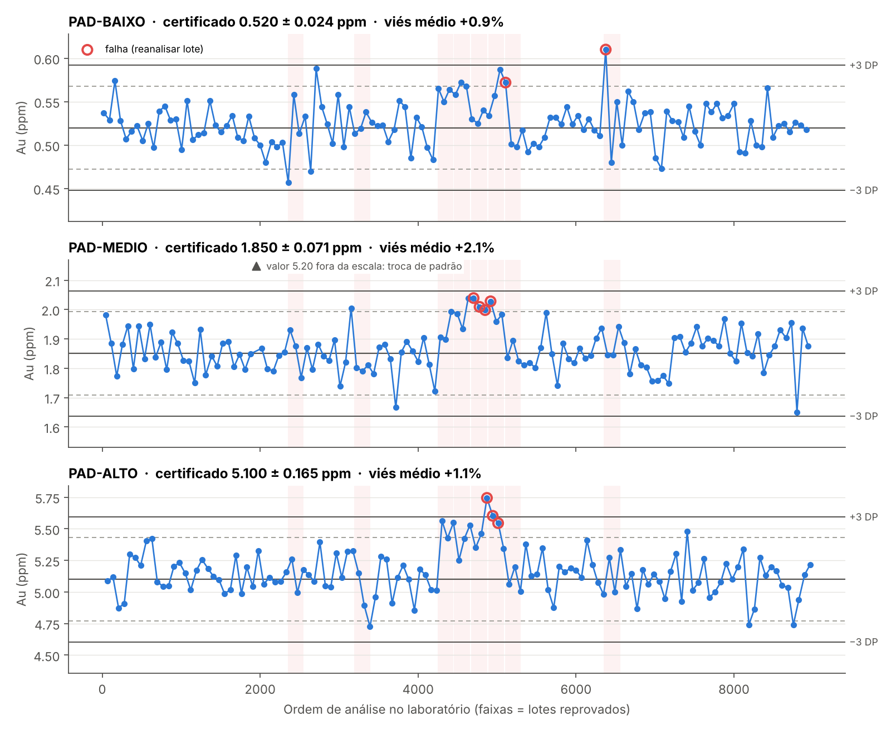
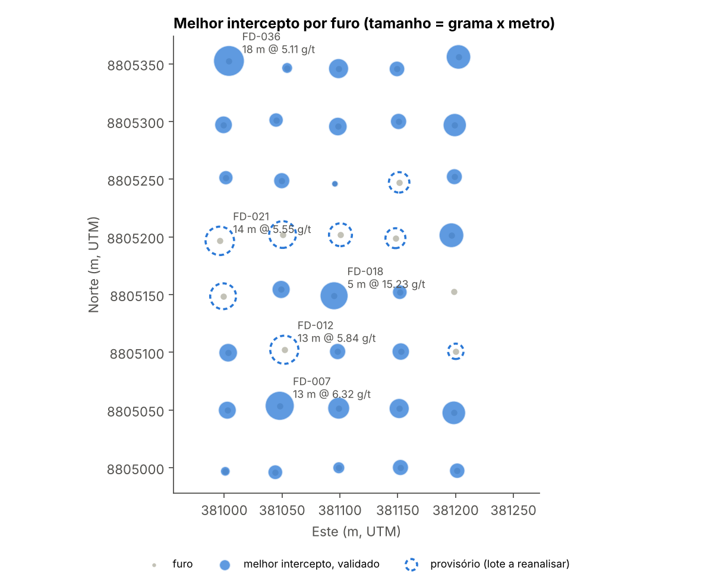

# QA/QC e validação de banco de dados de sondagem

**Pergunta:** os teores de ouro deste banco de sondagem são confiáveis para entrar numa estimativa de recurso? Se não forem, quais lotes precisam voltar ao laboratório e quais resultados ficam em espera?

Este projeto reproduz a rotina de um analista de dados geológicos: receber as planilhas de campo e os laudos do laboratório, **validar o banco** (furos, intervalos, códigos, unidades), rodar o **QA/QC** das análises (padrões certificados, brancos e duplicatas) e entregar uma **lista de ação**: o que foi corrigido, o que precisa de revisão e quais lotes devem ser reanalisados.

> Os dados são **simulados** (projeto de ouro fictício com 40 furos e 7.630 m de sondagem), porque bancos reais de empresas são confidenciais. A simulação segue o formato usual de exportação (collar, survey, litologia, amostragem, laudo) e inclui de propósito os problemas que aparecem na prática.

Portfólio: https://leticiacerqueira.github.io

## Ferramentas
Python (pandas, NumPy, Matplotlib) · SQL (SQLite: CTEs, window functions, gaps and islands)

## Etapas
| Script | O que faz |
|---|---|
| `src/01_gerar_dados.py` | Gera o banco simulado: 40 furos, 7.630 amostras de rotina e 1.347 amostras de controle (15% do fluxo) em 43 lotes de laboratório. |
| `src/02_validar_banco.py` | Valida e trata o banco. Cada problema vira uma linha em `saida/log_validacao.csv` com a regra que falhou e a ação: **CORRIGIDO** (correção objetiva e rastreável) ou **REVISAR** (depende de quem conhece o furo). |
| `src/03_qaqc.py` | Cartas de controle dos padrões, gráfico de brancos, precisão das duplicatas (HARD) e decisão por lote: **APROVADO** ou **REANALISAR**. |
| `src/04_consultas_sql.py` + `sql/consultas.sql` | Carrega tudo num SQLite e calcula interceptos significativos, ranking de furos, teor por litologia, impacto do QA/QC e pendências por furo. |

## 1. Validação do banco
**22 ocorrências: 12 corrigidas e 10 para revisar** ([log completo](saida/log_validacao.csv)).

| Tabela | Exemplo encontrado | Ação |
|---|---|---|
| Collar | FD-017 com este e norte trocados (detectado pela faixa de coordenadas UTM) | Corrigido |
| Collar | FD-033 com mergulho +60 no collar e −60 no survey | Corrigido |
| Collar | FD-029 sem cota | Revisar |
| Survey | FD-008: azimute muda 39° entre 60 m e 90 m e volta depois (leitura ruim) | Revisar |
| Litologia | `Xisto`, `xisto `, `QZ-SULFETO`: códigos fora do padrão | Corrigido |
| Litologia | sobreposição em FD-014, lacuna de 1,5 m em FD-025, intervalo além do fundo do furo em FD-038 | Revisar / corrigido |
| Amostragem | amostras lançadas no furo `FD-40`, que não existe (era FD-040) | Corrigido |
| Laudo | resultado em ppb no lugar de ppm (6420 → 6,42 g/t), valor −0,005, códigos `-`, `IS`, `NR`, amostra repetida, amostra que não voltou | Corrigido / revisar |

A lacuna de FD-025 não é detalhe: ela cai **dentro de um intercepto de 10 m a 5,96 g/t**, e a amostra fica sem litologia nas estatísticas até o geólogo descrever o trecho.

## 2. QA/QC das análises
Critérios usados (referências comuns na indústria, ajustáveis no início de `03_qaqc.py`):
- **Padrão certificado:** falha fora de ±3 DP, ou 2 seguidos fora de ±2 DP do mesmo lado, ou média do lote além de ±1,5 DP (viés).
- **Branco:** falha acima de 10 × o limite de detecção (0,05 g/t).
- **Duplicatas:** 90% dos pares com HARD ≤ 10% (polpa) e ≤ 20% (campo). HARD = |A − B| / (A + B).



- **Deriva do laboratório nos lotes L021 a L024:** os três padrões sobem juntos (média do lote de +1,8 a +2,0 DP). Nenhum ponto isolado parece grave, mas a sequência mostra que o laboratório passou a ler alto. Os 4 lotes vão para reanálise, junto com L025, onde o PAD-BAIXO ainda saiu acima de 2 DP pela segunda vez seguida (fim da deriva).
- **L031:** PAD-BAIXO a +3,7 DP, falha pontual. Lote reprovado.
- **L010:** amostra etiquetada como PAD-MEDIO com valor de 5,20 g/t, que é o PAD-ALTO. É **troca de padrão no envio**, não erro do laboratório: corrige-se o cadastro e o lote não é reprovado. Sem essa checagem, um lote bom seria reanalisado à toa.


- 2 brancos contaminados (0,17 e 0,23 g/t), **sempre logo depois de amostras com mais de 17 g/t**: arraste de material na preparação. L012 e L016 voltam ao laboratório, e a recomendação é limpar o britador com quartzo após amostras com ouro visível.


| Tipo | Pares válidos | Dentro do limite | Resultado |
|---|---:|---:|---|
| Duplicata de polpa | 91 | 97,8% | Aprovado |
| Duplicata de campo | 99 | 83,8% | **Reprovado** |

A polpa repete bem, então **o laboratório é preciso**. A diferença está na duplicata de campo (a outra metade do testemunho): é o **efeito pepita** do ouro grosso, que muda o teor de uma metade para a outra. Isso não se resolve no laboratório e sim na amostragem: amostra maior, testemunho inteiro na zona mineralizada ou análise por *screen fire assay*.

## 3. Resultado para o projeto (SQL)
**8 de 43 lotes precisam de reanálise** (L012, L016, L021 a L025, L031). Eles contêm 18,9% das amostras e **21,2% das amostras mineralizadas** (≥ 0,3 g/t).

Dos **42 interceptos significativos** (≥ 0,3 g/t e ≥ 2 m, calculados em SQL com a técnica *gaps and islands*), **8 ficam provisórios** até a reanálise, entre eles 2 dos 5 melhores furos.



| Posição | Furo | Intercepto | Status |
|---:|---|---|---|
| 1 | FD-036 | 18 m @ 5,11 g/t | Validado |
| 2 | FD-007 | 13 m @ 6,32 g/t | Validado |
| 3 | FD-021 | 14 m @ 5,55 g/t | Provisório |
| 4 | FD-018 | 5 m @ 15,23 g/t | Validado |
| 5 | FD-012 | 13 m @ 5,84 g/t | Provisório |

Consultas em [`sql/consultas.sql`](sql/consultas.sql) e resultados em [`saida/sql/`](saida/sql/). A lista de pendências por furo ([`05_pendencias_por_furo.csv`](saida/sql/05_pendencias_por_furo.csv)) é o que vai para a equipe de geologia.

## Conclusão
O banco **ainda não está pronto** para estimar recurso: 8 lotes precisam voltar ao laboratório, 10 itens precisam de revisão do geólogo e a amostragem da zona mineralizada precisa ser revista por causa do efeito pepita. A parte boa: o laboratório é preciso, e quase todos os problemas do banco foram corrigidos de forma rastreável, com o log mostrando o que mudou e por quê.

## Como rodar
```bash
pip install pandas numpy matplotlib
python src/01_gerar_dados.py
python src/02_validar_banco.py
python src/03_qaqc.py
python src/04_consultas_sql.py
```

## Autora
Leticia Santos Cerqueira · Geóloga e Analista de Dados · [LinkedIn](https://www.linkedin.com/in/leticiasantoscerqueira/)
